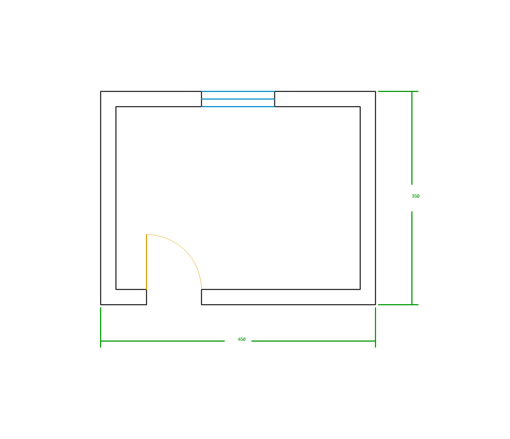
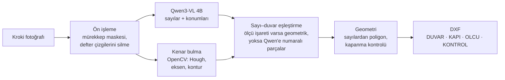

# Mimarlık Uygulaması: El Çizimi Krokiden AutoCAD'e

Mimarların sahada elle çizdiği **röleve krokisinin fotoğrafını** alıp **AutoCAD'de açılıp düzenlenebilen
bir DXF dosyasına** dönüştüren bir Python projesi. Hedef "%100 otomatik" değil: program bir **taslak**
çiziyor ve emin olmadığı her yeri işaretliyor; kullanıcı birkaç sayıyı düzelterek sonuca ulaşıyor.

> Proje geliştirme aşamasında (Faz 2 / 6). Alan danışmanları bir mimar ve bir iç mimar; mimari kurallar
> ve gerçek iş akışı onlardan öğreniliyor.



*Koddan üretilen örnek oda (`python -m mimarlik.demo_oda`): duvarlar, kapı, pencere ve ölçüler ayrı
katmanlarda; AutoCAD'de açılıp düzenlendi. Önizleme `araclar/dxf_resim.py` ile çizildi.*

## Neden zor?

- **Krokiler ölçeksiz.** Kâğıtta aynı boyda çizilmiş iki duvarın yanında `180` ve `140` yazabiliyor.
  Bu yüzden "pikselleri ölçekle" yaklaşımı çalışmıyor; doğru bilgi **duvarların yanına yazılan sayılar**.
  Program krokiden yalnızca duvarların **sırasını ve yönünü** alıyor, geometriyi **sayılardan** kuruyor.
- **Ölçüler el yazısı:** eğik, yan yazılmış, defter çizgilerinin üstünde, bazen bir ölçü işaretiyle kesilmiş.
- **Hangi sayı hangi duvarın?** Sayı en yakın duvara ait olmayabilir; köşelerde ve kısa duvarlarda
  belirsizlik büyük. Bazı sayıların anlamı (ör. `10 · 90 · 15` duvar–kapı–duvar mı?) mimara bağlı.
- **Kapanma:** Okunan sayılarla çizilen oda kapanmıyorsa bir sayı yanlış okunmuş ya da yanlış duvara
  bağlanmıştır; program bunu bulup göstermeli.

## Mimari



| Adım | Modül | Ne yapıyor |
|---|---|---|
| Ön işleme | `mimarlik/on_isleme.py` | Mavi mürekkebi renkle (HSV) ayırıyor, defter çizgilerini siliyor, karakter yüksekliğini ölçüyor |
| Okuma | `mimarlik/okuma.py` | Yerel Qwen3-VL'den sayıları ve kutularını alıyor (Ollama) |
| Kenar bulma | `mimarlik/kenar_bulma.py` | Çizgi parçaları → eksen açısı → birleştirme → duvar / ölçü işareti / açıklık ayrımı → dış kontur |
| Eşleştirme | `mimarlik/eslestirme.py`, `bolge_bulma.py`, `birlestirme.py` | Sayı bölgesi → değer atama (Macar algoritması) → parçaya bağlama; iki yolun birleşimi |
| Geometri | `mimarlik/geometri.py` | Kenar boylarını sayılardan kuruyor; eksik boyu kapanmadan hesaplıyor; kapanmayan ekseni raporluyor |
| DXF | `mimarlik/plan_cizimi.py`, `dxf_yazici.py` | İç/dış duvar yüzü, kapı, ölçüler; emin olunmayan her şey kırmızı **KONTROL** katmanında |
| Varsayımlar | `mimarlik/varsayimlar.py` | Mimara sorulan kurallar (duvar kalınlığı, `300` köşeden köşeye mi…) tek dosyada |

## Deney sonuçları

Her yöntem kararından önce ölçüm yapıldı. Tüm raporlar `deneyler/` altında. Veri: iki tek odalı gerçek
kroki, **24 ölçü sayısı**. Küçük bir veri seti; sonuçlar yön göstermek için.

### Sayı okuma (OCR)

| Yöntem | Doğru / 24 | Uydurma sayı | Süre / kroki | Nerede çalışıyor |
|---|---|---|---|---|
| EasyOCR (klasik OCR) | 5 | 16 | ~10 s | yerel |
| Gemini Flash (bulut) | **24** | 0 | 45–75 s | Google sunucusu |
| Qwen3-VL 4B, ham fotoğraf | 22–23 | 1 | ~50 s | yerel, GTX 1650 4 GB |
| Qwen3-VL 4B, çizgi silme, sadece sayı istemi | 23 / 23 / 23 | 1 | ~57 s | yerel, GTX 1650 4 GB |
| **Qwen3-VL 4B, çizgi silme + konumlu istem (ürünün kullandığı)** | **22 / 22 / 22** | 0–11 | ~2–3,5 dk | **yerel**, GTX 1650 4 GB |

**Neden yerel model?** Fark kroki başına yaklaşık bir sayı, ve ürün zaten kullanıcının düzelteceği bir
taslak üretiyor. Buna karşılık yerel model:
- **Gizlilik:** Krokiler müşteri işi olabilir; fotoğraflar bilgisayardan çıkmıyor.
- **Maliyet ve erişim:** Ücretsiz, kota yok. Bulut modelin bir sonraki sürümü ücretsiz katmanda sürekli
  "sunucu meşgul" hatası verdi.

Denenip bırakılan fikirler de ölçüldü: sayıyı kesip büyütüp tekrar okutmak **kötüleştirdi** (14–15/24),
defter çizgilerini silmek az iyileştirdi. Ürün sayıların **konumunu** da istediği için (eşleştirme bunu
kullanıyor) okuma bir sayı düşüyor, fazla sayı artıyor (çoğu tekrar yazılan `40`) ve süre 2–3 katına çıkıyor;
fazla sayılar eşleştirmede "emin değilim" olarak kullanıcıya düşüyor. Kalan hata (`102`'nin `162` okunması) bir ölçü
işaretinin sayının içinden geçmesinden; bu tür hataları geometri kontrolü ve kullanıcı onayı yakalıyor.

### Sayı–duvar eşleştirme

| Yaklaşım | Kenarlar | Doğru bağlanan / 24 |
|---|---|---|
| Geometrik, üst sınır (doğru kutu ve değerlerle) | gerçek | 19 |
| Qwen'e numaralı duvar parçalarını sormak (Y2) | gerçek | 18–19 |
| Geometrik, gerçekçi koşul | bulunan | 10–14 |
| **Y2, gerçekçi koşul** | bulunan | **12–17** |
| Tavan: kenarı bulunabilen sayılar | bulunan | 17 |

- Ölçü işaretiyle (tire) bağlanan sayılar **9/9 doğru**. Bu yüzden **birleşik yol** seçildi: tire varsa
  geometri, yoksa Y2; iki yol çelişirse "emin değilim" deniyor ve kullanıcıya soruluyor.
- Darboğaz artık **kenar bulma** (kısa duvar parçaları). Kısa parçaların anlamı mimara soruldu; kural
  cevaptan sonra yazılacak.

## Durum ve yol haritası

| Faz | İçerik | Durum |
|---|---|---|
| 0 | Gerçek örnek krokiler, ortam, repo | ✅ 7 kroki toplandı |
| 1 | DXF üretimi (`ezdxf`): katmanlar, ölçüler, birim | ✅ AutoCAD'de açılıp düzenlendi |
| 2 | Tek oda krokisinden DXF | 🔄 Uçtan uca çalışıyor, mimarın cevapları işlendi; doğru ölçülü örnek bekleniyor |
| 3 | Çok odalı planlar, kapı/pencere/kolon sembolleri, eğik duvarlar | ⏳ |
| 4 | Web arayüzü (FastAPI): telefonda kamerayla yükleme, bilgisayarda düzeltme ekranı | ⏳ |
| 5 | DXF'e mobilya blokları ekleme (iç mimar modülü) | ⏳ |
| 6 | 2D plandan basit 3D | ⏳ |

**Şu anki dürüst durum:** İki kolay krokinin ikisinde de dış kontur bulunuyor ve DXF çıkıyor. İkisinde de oda
kapanmıyor, ve kapanmaması gerekiyor: **kapanma kontrolü örnek krokilerdeki gerçek çizim hatasını yakaladı.** Mimar,
toplamların tutmadığını ve krokileri hatalı çizdiğini doğruladı (fark yatay 40–48, dikey 53–60 cm). Program farkı
KONTROL katmanında gösteriyor. 24 sayının 6–11'i hâlâ yanlış duvara bağlanıyor; bu bilinen ve ölçülmüş bir eksik.
Bu iki kroki geometri ve kapanma doğruluğu için değil, hatalı çizimi yakalama testi olarak kullanılıyor (okuma ve
bağlama ölçümünde geçerliler); geometri doğruluğu, mimarın düzelttiği ölçülerle ölçülecek.

## Kurulum

Gereken: Python 3.13, [Ollama](https://ollama.com) (yalnızca kroki okuma için).

```bash
python -m venv .venv
.venv/Scripts/pip install -r requirements.txt     # Linux/macOS: .venv/bin/pip
ollama pull qwen3-vl:4b-instruct                  # ~3,3 GB
```

## Kullanım

```bash
# Kroki fotoğrafı -> output/<ad>.dxf + output/<ad>.json (okunan sayılar, bağlamalar, kapanma)
python -m mimarlik.kroki kroki.jpg

# Qwen'i yeniden çağırmadan, önceki çalıştırmanın kayıtlı cevaplarıyla
python -m mimarlik.kroki kroki.jpg --okuma output/kroki.json

# Koddan örnek oda DXF'i (yukarıdaki görsel)
python -m mimarlik.demo_oda

# DXF önizlemesi (AutoCAD olmadan gözle kontrol)
python -m araclar.dxf_resim output/oda_demo.dxf output/oda_demo.png

# Testler (Qwen gerektirmez)
python -m pytest
```

Çıktı DXF'te katmanlar: **DUVAR**, **KAPI**, **PENCERE**, **OLCU** ve kırmızı **KONTROL**. KONTROL'de
kapanmayan duvarlar, kapanma farkı ("yatay fark 40 cm"), sayıdan değil hesaptan gelen boylar ve
"emin değilim" denen her sayı nedeniyle birlikte duruyor.

## Teknolojiler ve yöntem

- **Python**, **OpenCV** (görüntü işleme), **ezdxf** (DXF), **SciPy** (atama), **Ollama + Qwen3-VL** (görüntü
  anlayan yerel dil modeli), **pytest** (150 birim/uçtan uca test; yapay kroki ve sahte model ile).
- Deney önce, karar sonra: her yaklaşım ölçüldü, sonuçlar ve bırakılan fikirler raporlarda.
- Gizlilik: örnek krokiler ve onlardan üretilen görseller depoya hiç girmiyor (`.gitignore`).

```
mimarlik/    ana paket (ön işleme, okuma, kenar bulma, eşleştirme, geometri, DXF)
tests/       testler ve yapay kroki üreticisi
deneyler/    OCR, konum, kes-okut, çizgi silme ve eşleştirme deneyleri (raporlarıyla)
araclar/     yardımcı araçlar (DXF önizleme)
docs/        tasarım ve plan belgeleri
```

## Geliştirici

**Mehmet Korkut**, Bilgisayar Mühendisliği 4. sınıf, İstanbul Gelişim Üniversitesi ·
[github.com/mehmet-korkut2](https://github.com/mehmet-korkut2)

Geliştirmede yapay zekâ destekli kodlama aracı Claude Code kullanıldı; problem tanımı, deney tasarımı ve
teknik kararlar bana ait.

---

## English summary

**Hand-drawn survey sketch → editable AutoCAD DXF.** Architects sketch rooms on site by hand; this
Python project turns a photo of such a sketch into a layered DXF that opens and edits in AutoCAD.
The sketches are **not to scale**, so the geometry is rebuilt from the **handwritten dimensions**:
the program reads the numbers with a local vision-language model (**Qwen3-VL 4B** via Ollama),
detects walls with **OpenCV**, matches each number to its wall (geometric binding when a dimension tick
is found, otherwise asking the model about numbered wall segments), builds the polygon from the numbers,
and checks whether it closes. Anything uncertain (conflicting matches, non-closing walls) is drawn on a
red **KONTROL** layer for quick human correction: the goal is a fast-to-fix draft, not full automation.

Every design choice was measured first (24 handwritten numbers from real sketches): the local model reads
22/24 in the exact product setting (notebook lines removed, numbers requested with their positions) versus 24/24 for a cloud model and 5/24 for classic OCR, and was chosen for privacy (client
drawings never leave the machine) and zero cost. The end-to-end pipeline works; the current bottleneck is
wall detection on short segments, pending input from the architect advisor. Stack: Python, OpenCV, ezdxf,
SciPy, Ollama/Qwen3-VL, pytest (150 tests).
